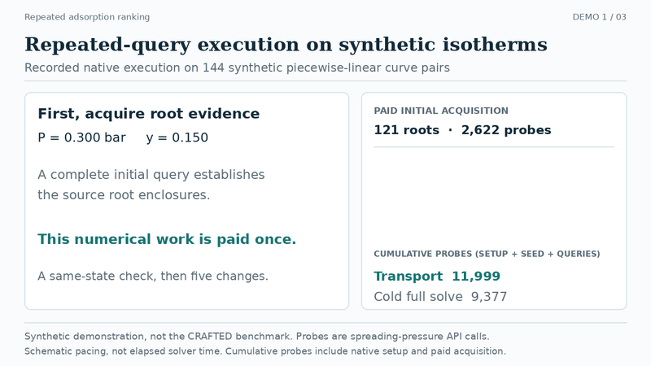
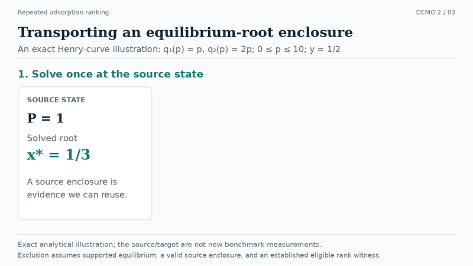
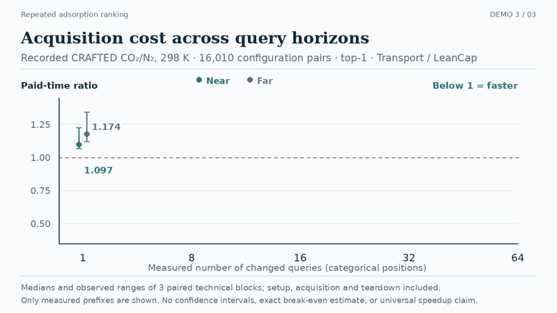

<div align="center">

# Transporting Root Evidence<br>for Repeated Adsorption Ranking

**Zijia Wang**

[Paper](docs/assets/paper.pdf) · [Project Page](https://oliverdou776.github.io/Transporting-Root-Evidence-for-Repeated-Adsorption-Ranking/) · [Video demonstrations](https://oliverdou776.github.io/Transporting-Root-Evidence-for-Repeated-Adsorption-Ranking/#demonstrations) · [Installation](#installation) · [BibTeX](#citation)

</div>

[](https://oliverdou776.github.io/Transporting-Root-Evidence-for-Repeated-Adsorption-Ranking/media/query-replay.mp4)

**Repeated top-k queries over implicit equilibrium scores.** The animation replays native execution on 144 synthetic piecewise-linear curve pairs. A pressure/composition change updates the top-5 ranking while historical root bounds are retained. All six queries are checked against complete solving. The displayed work counters come from the implementation; animation pacing is unrelated to solver runtime. [Watch MP4](docs/media/query-replay.mp4) · [Demo input and outputs](docs/media/query-replay-data.json).

## Abstract

Pressure and composition sweeps repeatedly rank adsorption materials while reusing the same pure-gas curves. Each mixture score requires an implicit equilibrium, and a warm start reduces its cost only after the candidate reaches the numerical solver. Transporting a previously established root enclosure can exclude a candidate before a new integral evaluation. For binary ideal adsorbed solution theory, two partial-pressure ratios give an arithmetic destination enclosure conditional on supported equilibrium. We derive its containment and widening, and integrate it with distinct eligible lower witnesses and a shared static cap index. Solved brackets and fresh negative threshold tests use the same interface; direct-score predicates and an unknown outcome handle numerical uncertainty. A ten-policy study uses 353 NIST curve pairs and 16,010 CRAFTED configuration pairs. On four 64-query CRAFTED streams, paid transport costs 0.456–0.655 times lean cap indexing; a separate matched study gives 0.485–0.623 times on-demand warm solving, with every paired block favorable. Every original one-query CRAFTED prefix loses to LeanCap and Incumbent; none in the separate study beats on-demand warm solving in all blocks. Matched warm and solved-root controls locate the demonstrated benefit in historical root bounds; additional negative-witness retention does not consistently improve paid time. Size and arrival studies expose further losses. A separately timed 0.01–1 bar sweep adds a NIST mixture relation and shows both gains and losses depending on acquisition pressure and k.

## Method

The engine ranks candidate binary mixtures by IAST selectivity. Pure-gas isotherms are positive piecewise-linear curves with a linear origin rule and declared finite upper support. Computing a score requires solving an implicit equilibrium.

A previous root enclosure can be transported to a new pressure/composition state using two partial-pressure ratios, conditional on supported equilibrium. The destination bound may exclude a candidate before another integral evaluation. A shared static cap index schedules candidates, and distinct currently eligible candidates supply lower witnesses for top-k selection. Inconclusive numerical predicates trigger refinement.


**Analytic example.** For q₁(p) = p and q₂(p) = 2p, the equal-feed source root is x* = 1/3. After pressure changes from 1 to 1.1, the transported score upper bound is 11/19, below a cutoff of 1. This excludes the candidate without a fresh integral evaluation. A wider bound from a negative threshold test remains inconclusive. The animation below separates this mechanism illustration from measured performance.

## Video demonstrations

| Root-enclosure transport | Acquisition and repeated-query cost |
|---|---|
| [](https://oliverdou776.github.io/Transporting-Root-Evidence-for-Repeated-Adsorption-Ranking/media/root-transport.mp4) | [](https://oliverdou776.github.io/Transporting-Root-Evidence-for-Repeated-Adsorption-Ranking/media/acquisition-cost.mp4) |
| Exact analytic illustration of the bound and threshold decision. [MP4](docs/media/root-transport.mp4) | Recorded CRAFTED prefixes, including the initial acquisition loss. [MP4](docs/media/acquisition-cost.mp4) |

The [project page](https://oliverdou776.github.io/Transporting-Root-Evidence-for-Repeated-Adsorption-Ranking/) provides video controls, captions and full-size figures. GIF previews link to the corresponding videos. No animation represents a real-time benchmark.

## Experimental results

The representative CRAFTED near/top-1 stream ranks 16,010 CO₂/N₂ configuration pairs at 298 K over 64 queries. Separate arm medians are **2.6127 s** for Transport and **5.2196 s** for LeanCap; the within-block median ratio is **0.500**. Native preparation, acquisition, output conversion and teardown are included. Common data loading, immutable pool preparation, native compilation/loading and reference checks are outside the timers.

**Paid-time ratios at 64 queries.** Smaller than 1 favors Transport. Each ratio is a median over three paired technical blocks. The WarmOnDemand comparison uses a separate set of clocks. “Faster blocks” refers to the original LeanCap comparison.

| Relation | Stream | k | Transport / LeanCap | Faster blocks | Transport / WarmOnDemand |
|---|---|---:|---:|---:|---:|
| CRAFTED | near | 1 | 0.500 | 3/3 | 0.485 |
| CRAFTED | near | 50 | 0.456 | 3/3 | 0.492 |
| CRAFTED | far | 1 | 0.601 | 3/3 | 0.584 |
| CRAFTED | far | 50 | 0.655 | 3/3 | 0.623 |
| NIST | near | 1 | 0.744 | 3/3 | 0.617 |
| NIST | near | 50 | 0.761 | 3/3 | 0.767 |
| NIST | far | 1 | 0.831 | 3/3 | 0.833 |
| NIST | far | 50 | 1.029 | 1/3 | 0.961 |

CRAFTED has 16,010 configuration pairs, which can share materials; original NIST has 353 CO₂/CH₄ curve pairs. Three technical blocks provide descriptive medians and observed ranges, not confidence intervals. All original one-query CRAFTED prefixes lose to LeanCap. Larger state changes, small pools, high k and unfavorable acquisition states can remove the benefit. Historical solved-root bounds account for the demonstrated savings; additional negative-witness retention does not consistently improve paid time.

[All 160 curated prefix comparisons](evidence/published_results.csv) · [Exact values, observed ranges and provenance](evidence/published_results.json) · [Full paper](docs/assets/paper.pdf)

## Installation

The implementation requires **GNU/Linux, Python 3.10+, NumPy and GCC with libquadmath**. No GPU is required. On Ubuntu/Debian, install `g++` if absent.

```bash
git clone https://github.com/OliverDOU776/Transporting-Root-Evidence-for-Repeated-Adsorption-Ranking.git
cd Transporting-Root-Evidence-for-Repeated-Adsorption-Ranking
python -m venv .venv
source .venv/bin/activate
python -m pip install .
python examples/repeated_ranking.py
```

The native library compiles on first use into the user cache. `ROOT_TRANSPORT_CACHE` selects another cache directory.

## Usage

```python
from root_transport import StreamRanker, load_corpus

curves, pairs, metadata = load_corpus("corpus.json")
with StreamRanker(curves, pairs, method="transport") as ranker:
    ranker.seed(P=0.3, y=0.15)
    result = ranker.query(P=0.305, y=0.152, k=5)
    print(result)
```

`seed` acquires evidence by solving the supported source pool; this cost must be included in lifecycle comparisons. Supported stream methods are `transport`, `roots`, `cap` and `warm`. The comparison example additionally includes unseeded on-demand warm solving and the incumbent baseline.

A minimal JSON corpus is:

```json
{
  "curves": [
    {"p": [0, 0.1, 1, 10], "q": [0, 0.1, 0.8, 2]},
    {"p": [0, 0.1, 1, 10], "q": [0, 0.2, 1.2, 3]}
  ],
  "pairs": [[0, 1]]
}
```

Pressures must strictly increase. Non-origin pressures and uptakes must be positive. The caller supplies compatible pressure/uptake units; the loader performs no conversion or high-pressure extrapolation. Object-form pairs with `i`, `j`, `family` and `temperature` fields support corpus filtering and original ID mapping.

```bash
python examples/rank_corpus.py corpus.json --pressure 0.3 --feed 0.15 --top-k 1
python examples/compare_executors.py
```

## Reproducibility

```bash
python -m pip install '.[test]'
python -m pytest -q
```

Tests cover analytic Henry-law scores, support boundaries, threshold predicates, deterministic ties, invalid inputs and nonlinear stream agreement with complete solving. The six-arm comparison example checks all returned outputs on a common workload. The native mathematical kernel is retained from the paper implementation, with packaging and lifecycle handling around it.

The demonstration inputs, renderer and regeneration instructions are provided in [docs/media/README.md](docs/media/README.md). CRAFTED/NIST curve snapshots are not bundled; the loader also accepts the paper companion's processed corpus schema. The repository provides functional code and compact derived results, without internal run logs or research administration records. The included synthetic demonstrations and functional checks are separate from reproduction of the complete paper campaign.

| Directory | Contents |
|---|---|
| `src/root_transport/` | Native numerical engine and Python API |
| `examples/` | Repeated-query and matched-executor examples |
| `scripts/` | Reproducible demonstration generation |
| `tests/` | Analytic and nonlinear functional checks |
| `docs/` | GitHub Pages source, paper, figures and videos |
| `evidence/` | Curated publication-level result summaries |

The numerical tests have finite coverage. They do not establish all-domain floating-point soundness, experimental IAST accuracy or physical validation. See the paper for the full model and evaluation scope.

## Citation

```bibtex
@misc{wang2026transporting,
  title  = {Transporting Root Evidence for Repeated Adsorption Ranking},
  author = {Wang, Zijia},
  year   = {2026},
  url    = {https://github.com/OliverDOU776/Transporting-Root-Evidence-for-Repeated-Adsorption-Ranking}
}
```

## Attribution

Software and manuscript: **Zijia Wang**. Third-party adaptations retain their upstream notices; see [NOTICE.md](NOTICE.md). The project page is an original implementation informed by the organization of [VGGT](https://vgg-t.github.io/), [ReAct](https://react-lm.github.io/), [WebArena](https://webarena.dev/og/) and [Self-Refine](https://selfrefine.info/).
