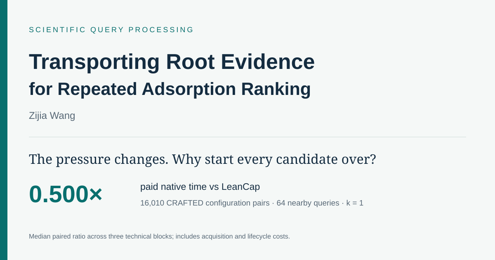
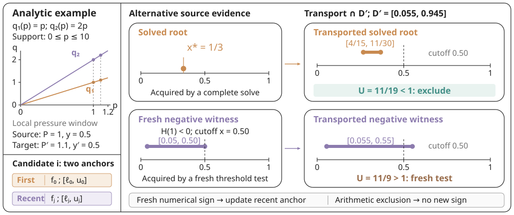

<div align="center">

# Transporting Root Evidence<br>for Repeated Adsorption Ranking

**Zijia Wang**

### A pressure change need not mean a fresh equilibrium solve.

[**Paper**](docs/assets/paper.pdf) · [**Project Page source**](docs/) · [**Quickstart**](#quickstart) · [**Results**](#results) · [**Citation**](#citation)



</div>

You have **16,010 CO₂/N₂ configuration pairs** and a new pressure/composition state. Which candidate ranks first? Each score hides an equilibrium root. Solving every candidate again discards useful evidence from the previous query.

**Transport the previous root enclosure, then solve only where the ranking still needs it.** On the recorded CRAFTED near stream (298 K, top-1, 64 queries), paid native time falls from **5.22 s to 2.61 s**, including preparation, full acquisition and teardown. The paired median ratio is **0.500×** across three technical timing blocks. These are measured workload results; the first query pays an acquisition cost.

## What the code does

- **Rank binary adsorption mixtures** using a C++17 finite-support, piecewise-linear IAST engine exposed through Python.
- **Reuse root and threshold evidence** across pressure/composition queries to exclude candidates before fresh integral evaluations.
- **Compare execution strategies**: shared cap indexing, transported solved roots, additional negative witnesses, seeded warm solving, and on-demand warm solving.
- **Inspect the numerical work** through returned root/probe counters and score brackets.

The native mathematical kernel is retained from the paper implementation. This release adds a small installable API, examples and tests around it. The repository contains functional source and a curated result table; experiment logs and internal research records are excluded.

## Quickstart

Requires **GNU/Linux, Python 3.10+ and GCC with libquadmath**. On Ubuntu/Debian, install `g++` if it is absent. No GPU is required.

```bash
git clone https://github.com/OliverDOU776/Transporting-Root-Evidence-for-Repeated-Adsorption-Ranking.git
cd Transporting-Root-Evidence-for-Repeated-Adsorption-Ranking
python -m venv .venv
source .venv/bin/activate
python -m pip install .
python examples/repeated_ranking.py
```

The first call compiles the native engine into the user cache. Set `ROOT_TRANSPORT_CACHE` to choose another cache directory. Compilation is outside the examples' execution timers.

The bundled example uses **144 synthetic curve pairs** and verifies every returned top-k against full solving. It illustrates the API; it is separate from the paper's timing measurements.

```python
from root_transport import StreamRanker, load_corpus

curves, pairs, metadata = load_corpus("corpus.json")
with StreamRanker(curves, pairs, method="transport") as ranker:
    ranker.seed(P=0.3, y=0.15)  # acquire evidence; this has a cost
    result = ranker.query(P=0.305, y=0.152, k=5)
    print(result)
```

### Use your curves

```json
{
  "curves": [
    {"p": [0, 0.1, 1, 10], "q": [0, 0.1, 0.8, 2]},
    {"p": [0, 0.1, 1, 10], "q": [0, 0.2, 1.2, 3]}
  ],
  "pairs": [[0, 1]]
}
```

`P` uses the same pressure unit as `p`; `y` is the first gas's feed fraction. All curves must use compatible uptake units. Non-origin pressures and uptakes must be positive, and pressures strictly increasing. The model includes a line to the origin and uses declared upper support. It performs no unit conversion or high-pressure extrapolation.

```bash
python examples/rank_corpus.py corpus.json --pressure 0.3 --feed 0.15 --top-k 1
python examples/compare_executors.py
```

The comparison example checks execution strategies against full solving and prints lifecycle costs. Supply `--help` for corpus and workload options. CRAFTED/NIST curve snapshots are not bundled; the loader accepts the paper companion's processed JSON schema as well as the compact schema above.

## How evidence moves

1. **Acquire** a root enclosure from a solved equilibrium or a fresh negative threshold test.
2. **Transport** it to the destination using two partial-pressure ratios, conditional on supported equilibrium.
3. **Exclude or refine** using a shared static cap index and eligible lower witnesses. An inconclusive numerical predicate triggers further work.



For the analytic curves shown above, a solved source root gives a destination score upper bound of **11/19 < 1**, excluding the candidate without a new integral evaluation. A wider negative witness still needs a fresh test. The analytic example explains the mechanism; the following table reports measurements.

## Results

**Paid-time ratio at 64 queries; lower is better.** Each entry is the median of three within-block ratios. All three paired blocks favor Transport in these eight comparisons. The two baseline columns come from separately timed studies.

| CRAFTED stream | Requested k | Transport / LeanCap | Transport / WarmOnDemand |
|---|---:|---:|---:|
| Near | 1 | **0.500×** | **0.485×** |
| Near | 50 | **0.456×** | **0.492×** |
| Far | 1 | **0.601×** | **0.584×** |
| Far | 50 | **0.655×** | **0.623×** |

The four original CRAFTED streams use **34.5–54.4% less paid time** than LeanCap. They contain 16,010 **configuration pairs**, which may share materials. Paid timing includes native preparation, indexing, any full acquisition, output conversion and teardown. Common JSON loading, immutable pool preparation, compilation/loading and correctness references are outside these timers.

**Reuse must repay acquisition.** All original one-query CRAFTED prefixes lose to LeanCap. Small pools, large k, wider state changes and an unfavorable acquisition state can lose too. On the separate 0.01–1 bar operating grid, acquisition at 0.01 bar loses at 64 CRAFTED queries; acquisition at 1 bar wins. Historical solved-root bounds drive the demonstrated benefit; extra negative-witness retention does not consistently beat Roots–Only.

[Interactive project-page source](docs/index.html) · [All 160 curated prefix rows](evidence/published_results.csv) · [Exact values and provenance](evidence/published_results.json)

Three technical blocks provide descriptive medians and observed ranges, not confidence intervals. This binary finite-support implementation and its numerical tests do not establish all-domain floating-point soundness or experimental IAST accuracy. See the paper for model assumptions and full comparisons.

## Repository guide

| Path | Purpose |
|---|---|
| `src/root_transport/` | Python API, corpus loader and native kernel |
| `examples/` | Repeated queries, user data and matched executor comparisons |
| `tests/` | Analytic and nonlinear correctness checks |
| `docs/` | Standalone project page, paper and vector figures |
| `evidence/` | Compact published result tables and source descriptions |

The standalone project page includes an interactive selector for recorded workload results. See [Pages deployment](docs/DEPLOYMENT.md) for the one-time repository setting needed for its public URL.

### Tests

```bash
python -m pip install '.[test]'
python -m pytest -q
```

Tests cover analytic Henry-law equilibria, threshold decisions, finite support, deterministic ties, input validation, corpus mapping and nonlinear repeated top-k agreement with full solving. The six-arm comparison script checks all included strategies on the same workload. These functional checks are separate from reproduction of the paper's full campaign.

## Citation

```bibtex
@misc{wang2026transporting,
  title  = {Transporting Root Evidence for Repeated Adsorption Ranking},
  author = {Wang, Zijia},
  year   = {2026},
  url    = {https://github.com/OliverDOU776/Transporting-Root-Evidence-for-Repeated-Adsorption-Ranking}
}
```

## Attribution

Software and manuscript: **Zijia Wang**. Third-party baseline adaptations retain their upstream notices. See [NOTICE.md](NOTICE.md) for source attribution and licensing scope.
